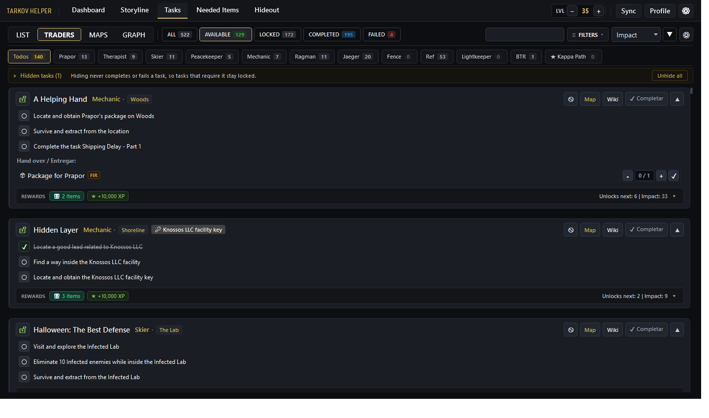
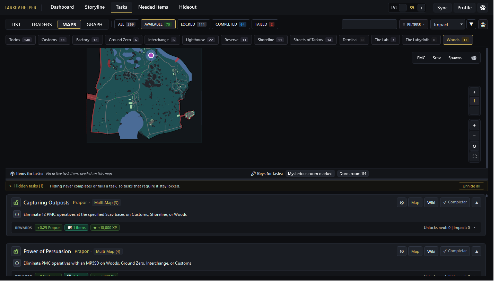
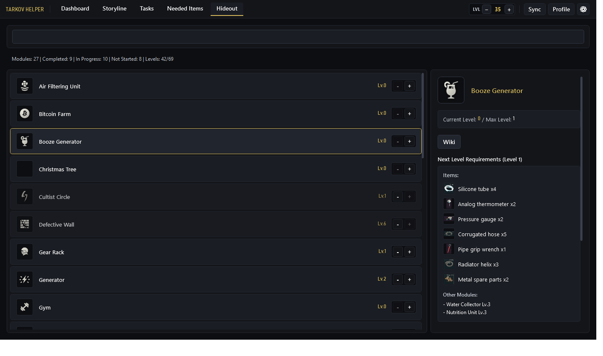

# Tarkov Helper

[](README.md)
[](README_ES.md)
[](README_KR.md)
[](https://microsoft.com/windows)
[](https://dotnet.microsoft.com/download/dotnet/8.0)
[](https://github.com/DenDiagonal/Tarkov-Helper/releases)
[](LICENSE)

**Tarkov Helper** is a modern, high-performance, offline-first tactical desktop companion for **Escape from Tarkov** on Windows. It streamlines your raids by tracking quest objectives, Hideout upgrades, Found-in-Raid (FIR) items, key requirements, and interactive vector maps with real-time player positioning—all without injecting into game memory or violating BattlEye terms of service.

---

## 📸 Screenshots

| Task & Quest Management | Interactive Vector Maps & Floors | Hideout & Module Upgrades |
| :---: | :---: | :---: |
|  |  |  |

---

## ✨ Key Features

### 🎯 Comprehensive Task & Quest Management
- **Tactical Quest Feed:** Modern interface inspired by the tactical EFT palette, featuring search, multi-trader filtering, and real-time status tracking.
- **586+ Quests & 2,018+ Objectives:** Full coverage of all traders (Prapor, Therapist, Skier, Peacekeeper, Mechanic, Ragman, Jaeger, Fence, Lightkeeper, and BTR Driver).
- **Dynamic Multi-Map Badges:** Quests spanning multiple locations (e.g., *Power of Persuasion*, *Capturing Outposts*, *A Shooter Born in Heaven*) display interactive multi-map badges.
- **Prerequisite Dependency Tree:** Clear visualization of prerequisite quests and unlocked follow-up tasks.
- **Kappa & Storyline Indicators:** Dedicated filters and badges for Kappa Container prerequisites, Lightkeeper milestones, and wipe/seasonal event tasks.
- **Direct Tarkov Wiki Integration:** Instant one-click access to official Escape from Tarkov Wiki articles for every quest and item.

### 🗺️ Interactive Multi-Layer Vector Maps (SVG) & Positioning
- **High-Fidelity Vector Maps:** Scalable vector maps for all EFT raids: Ground Zero, Customs, Streets of Tarkov, Woods, Factory, Reserve, Shoreline, Interchange, Lighthouse, and The Lab.
- **Subterranean & Multi-Floor Support:** Independent elevation layers and floor selectors for complex underground environments (Reserve Bunker, The Lab levels, Interchange floors, Customs dormitories).
- **Automated Elevation Floor Detection:** Automatically switches visible map floors based on the player's vertical elevation (Y-axis coordinate).
- **Passive Player Tracking (`PrintScreen`):** Pressing `PrintScreen` in-game records your position passively from EFT's official screenshot metadata—100% memory-safe and fully BattlEye compliant.
- **Transparent Overlay Minimap:** Borderless, click-through capable overlay window to display maps on a secondary monitor or directly on top of the game screen.
- **Interactive Objective Relocation:** Interactively adjust or fine-tune quest marker coordinates directly on the map, with a built-in history manager and one-click factory reset.

### 🔄 Independent PVP and PVE Game Modes
- **Zero Cross-Contamination:** Switch between **PVP** and **PVE** PMC profiles with a single click.
- **Isolated State Persistence:** Completed quests, key status, Hideout construction levels, inventory handovers, and user notes are stored separately for each mode in `user_data.db`.

### 📦 Hideout Planner & Material Tracking
- **Station Module Progression:** Track current and target construction levels for all Hideout stations (Booze Generator, Bitcoin Farm, Intelligence Center, Solar Power, etc.).
- **FIR vs. Standard Requirements:** Accurately distinguishes between Found-in-Raid (FIR) items and general barter/crafting materials.
- **The Collector Tracker:** Live monitoring of rare streamer items required for Fence's final quest.

### ⚡ Live Data Reconciliation Engine (Diff Viewer)
- **Live Remote API Synchronization:** Directly sync and reconcile task requirements with live upstream data from **TarkovTracker** and **Tarkov.dev**.
- **Visual Diff Viewer:** Inspect all additions, modifications, and deletions side-by-side before applying changes to your local database.
- **Automated Backup & Rollback:** Automatically creates timestamped `.bak` snapshots prior to any database update, with one-click restoration.

### 🔒 100% Offline-Capable & Memory-Safe
- **Offline-First:** All game data, icons, maps, and metadata reside locally in SQLite (`tarkov_data.db`). No mandatory internet connection required.
- **Non-Invasive:** Does not read or write EFT memory, hook DirectX/Vulkan APIs, or inject DLLs. Uses only file monitoring and standard Windows APIs.

---

## 🛠️ Architecture & Technology Stack

- **Framework:** .NET 8.0 (C# 12, WPF)
- **Architecture:** MVVM Pattern (Model-View-ViewModel) with responsive async task scheduling
- **Database:** SQLite via `Microsoft.Data.Sqlite` with transactional ACID updates
- **Vector Rendering:** `SharpVectors` for real-time SVG parsing and GPU-accelerated canvas rendering
- **Log Watcher:** Passive `FileSystemWatcher` streaming player coordinates and raid transitions
- **Deployment:** Self-contained single-folder application targeting `win-x64`

---

## 🚀 Download & Installation

### Option 1: Pre-built Binary (Recommended)
1. Download the latest release (`TarkovHelper-v1.5.8-win-x64.zip`) from [Releases](https://github.com/DenDiagonal/Tarkov-Helper/releases).
2. Extract the archive to any folder (e.g., `C:\Games\TarkovHelper`).
3. Run `TarkovHelper.exe`.
   - *Note:* The application is fully self-contained. You do **not** need to install any .NET runtime.

---

## 💻 Building from Source

### Prerequisites
- [Windows 10 / 11 (64-bit)](https://www.microsoft.com/windows)
- [.NET 8.0 SDK](https://dotnet.microsoft.com/download/dotnet/8.0)
- Visual Studio 2022 (with .NET desktop development workload) or Visual Studio Code

### Build Instructions
```powershell
# 1. Clone the repository
git clone https://github.com/DenDiagonal/Tarkov-Helper.git
cd Tarkov-Helper

# 2. Build in Release mode
dotnet build TarkovHelper\TarkovHelper.csproj -c Release

# 3. Publish self-contained executable to publish/ folder
dotnet publish TarkovHelper\TarkovHelper.csproj -c Release -r win-x64 --self-contained true -o publish
```

> [!IMPORTANT]
> Always publish using `--self-contained true` for `win-x64`. Verify that `publish\TarkovHelper.runtimeconfig.json` contains `"includedFrameworks"`.

---

## 🤝 Contributing

Contributions from the developer and Tarkov community are warmly welcomed! Whether you want to improve UI/UX, add new map overlays, enhance log parsing, or translate documentation, please check out [CONTRIBUTING.md](CONTRIBUTING.md) to get started.

---

## 📜 License & Legal Disclaimer

- This project is licensed under the [MIT License](LICENSE).
- **Escape from Tarkov** and all related assets, logos, and trademarks are property of **Battlestate Games Limited**.
- This application is an unofficial, community-developed companion tool and is neither affiliated with nor endorsed by Battlestate Games.
