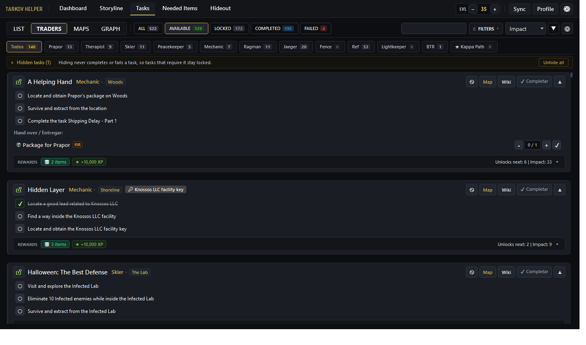
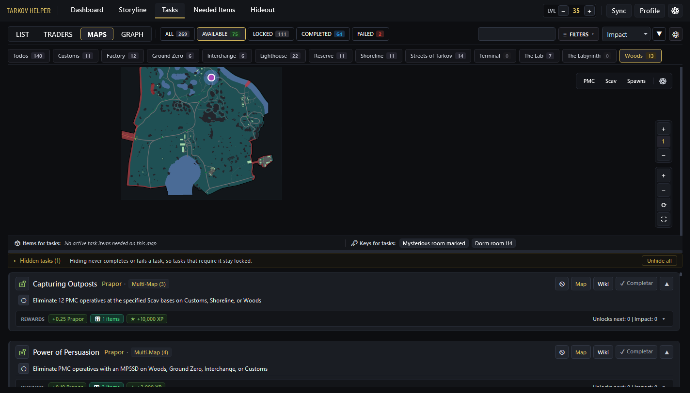
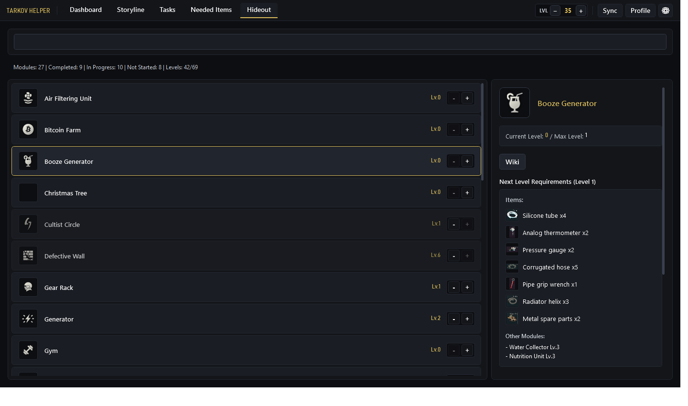

# Tarkov Helper

[](README.md)
[](README_EN.md)
[](README_KR.md)
[](https://microsoft.com/windows)
[](https://dotnet.microsoft.com/download/dotnet/8.0)
[](LICENSE)

**Tarkov Helper** is a modern, tactical Windows desktop application designed to track and enhance your raids in **Escape from Tarkov**. It tracks quest progression, Hideout station upgrades, Found in Raid (FIR) item requirements, needed keys, and interactive vector maps with real-time in-game positioning without altering game files or memory.

---

## 📸 Screenshots

| Quest Progression | Interactive Maps & Elevation | Hideout & Station Upgrades |
| :---: | :---: | :---: |
|  |  |  |

---

## ✨ Key Features

### 🎯 Quest Tracking & Management
- **Tactical Quest Feed:** Modern interface inspired by Escape from Tarkov and TarkovTracker dark palettes.
- **Dynamic Multi-Map Badges:** Quests spanning multiple locations (e.g., *Power of Persuasion*, *Capturing Outposts*, *A Shooter Born in Heaven*) display dynamic `Multi-Map` badges with full tooltips.
- **Requirement Dependency Graph:** Clear breakdown of prerequisites and quests unlocked upon completion.
- **Kappa & Seasonal Filters:** Specialized badges and quick filters for Collector/Kappa requirements and wipe-specific/seasonal quests.
- **Official EFT Wiki Links:** One-click redirection to official Escape from Tarkov wiki pages.

### 🗺️ Interactive SVG Vector Maps & Real-Time Positioning
- **High-Fidelity Vector Maps:** Real-time rendered vector maps featuring extracts (PMC, Scav, Transit), active quest objectives, and required keys.
- **Multi-Floor & Underground Support:** Discrete elevation handling and floor selectors for complex areas (Reserve Bunkers, The Lab, Interchange floors, Customs dorms, etc.).
- **Automatic Floor Detection:** Automatically switches floors based on player elevation (Y coordinate).
- **PrintScreen Coordinate Tracking:** Read player coordinates via the in-game `PrintScreen` key passively (100% safe, no memory injection, fully BattleEye compliant).
- **Overlay Mini-Map Mode:** Transparent, always-on-top window suitable for second monitors or overlay gameplay.

### 🔄 Dual Isolated Profiles (PVE & PVP)
- **One-Click Profile Switcher:** Seamlessly switch between PVP and PVE game modes.
- **Isolated State Persistence:** Completed quests, hideout modules, marked keys, and FIR inventories are preserved independently in `user_data.db`.

### 📦 Hideout & Item Requirements
- **Station Module Builder:** Track current levels and upgrade requirements for all Hideout stations.
- **FIR vs Regular Item Demands:** Clear separation between standard items and Found-in-Raid (FIR) requirements.
- **Collector Tracker:** Specialized dashboard for rare streamer items needed for Fence's Kappa quest.

### ⚡ Live API Reconciliation (Diff Engine)
- **Dual-Source Sync:** Connects directly with live **TarkovTracker** and **Tarkov.dev** APIs.
- **Interactive Diff Viewer:** When EFT updates, review quest changes, prerequisite revisions, and level alterations before applying them, never overwriting user progress or notes.

---

## 🚀 Installation & Usage

### System Requirements
- **OS:** Windows 10 or Windows 11 (64-bit).
- **Self-Contained:** No external .NET Runtime required; the published release includes all necessary dependencies.

### Quick Start
1. Go to the [Releases](../../releases) page.
2. Download `TarkovHelper-vX.X.X-win-x64.zip`.
3. Extract the ZIP to your chosen folder and run `TarkovHelper.exe`.

---

## 🛠️ Building from Source

### Prerequisites
- [.NET 8.0 SDK](https://dotnet.microsoft.com/download/dotnet/8.0)
- Visual Studio 2022 or VS Code with C# Dev Kit.

### Build Commands

1. **Clone the repository:**
   ```powershell
   git clone https://github.com/DenDiagonal/Tarkov-Helper.git
   cd Tarkov-Helper
   ```

2. **Restore and Build:**
   ```powershell
   dotnet build TarkovHelper\TarkovHelper.csproj -c Release
   ```

3. **Publish Self-Contained Windows x64 binary:**
   ```powershell
   dotnet publish TarkovHelper\TarkovHelper.csproj -c Release -r win-x64 --self-contained true -o publish
   ```
   > [!IMPORTANT]
   > The `--self-contained true` flag ensures the build includes all runtime libraries and avoids .NET runtime version conflicts on end-user machines.

---

## 🗄️ Local Data Architecture

All local data is segregated to safeguard player progress during updates:
- `user_data.db` — Local SQLite database storing user quest status (PVE/PVP), collected items, and custom notes.
- `tarkov_data.db` — Core database with official quest catalogs, objectives, requirements, keys, and hideout recipes.
- `app_settings.json` — User preferences, UI scaling, language settings, and log directory paths.

---

## 🤝 Contributing

Contributions, bug reports, and suggestions are welcome!
1. Fork the Project.
2. Create your Feature Branch (`git checkout -b feature/AmazingFeature`).
3. Commit your Changes (`git commit -m "feat: Add AmazingFeature"`).
4. Push to the Branch (`git push origin feature/AmazingFeature`).
5. Open a Pull Request.

---

## 📜 License & Legal Notice

Distributed under the [MIT](LICENSE) License.

**Legal Disclaimer:**
- Game data is powered by the [tarkov.dev](https://tarkov.dev) and [TarkovTracker](https://tarkovtracker.io) communities.
- *Escape from Tarkov* and related assets are registered trademarks of **Battlestate Games**. This application is an unofficial open-source tool developed for the EFT player community.
