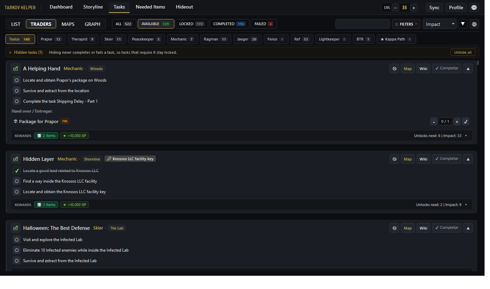
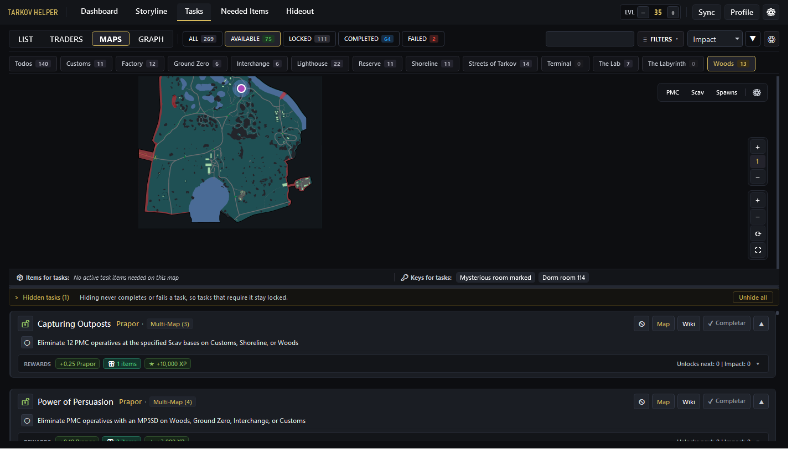
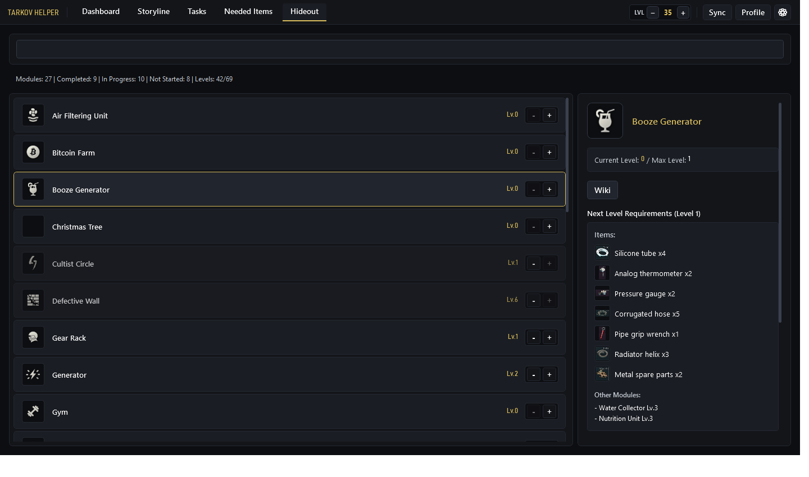

# Tarkov Helper

[](README.md)
[](README_ES.md)
[](README_KR.md)
[](https://microsoft.com/windows)
[](https://dotnet.microsoft.com/download/dotnet/8.0)
[](LICENSE)

**Tarkov Helper** es una aplicación de escritorio moderna y táctica para Windows diseñada para optimizar y acompañar tus incursiones en **Escape from Tarkov**. Permite gestionar el progreso de misiones, módulos del refugio (Hideout), requisitos de objetos (FIR), llaves necesarias y mapas interactivos con posicionamiento en tiempo real sin interferir con el juego.

---

## 📸 Capturas de Pantalla

| Gestión de Misiones | Mapas Interactivos y Niveles | Refugio y Módulos |
| :---: | :---: | :---: |
|  |  |  |

---

## ✨ Características Principales

### 🎯 Gestión Avanzada de Misiones
- **Feed Táctico de Misiones:** Interfaz intuitiva y moderna inspirada en la paleta táctica de EFT y TarkovTracker.
- **Badges Multi-Mapa Dinámicos:** Las misiones que abarcan múltiples escenarios (como *Power of Persuasion*, *Capturing Outposts* o *A Shooter Born in Heaven*) indican de forma dinámica todos los mapas válidos (`Multi-Map`).
- **Árbol de Requisitos:** Visualización clara de misiones previas y misiones que desbloquea al completarse.
- **Soporte Kappa y Estacionales:** Filtros y distintivos dedicados para misiones requeridas para el contenedor Kappa y eventos de wipe / temporadas.
- **Acceso Rápido a la Wiki:** Enlace directo de cada misión a la wiki oficial de Escape from Tarkov.

### 🗺️ Mapas Vectoriales Interactivos SVG y Posicionamiento
- **Mapas de Alta Fidelidad:** Mapas vectoriales renderizados en tiempo real con marcadores de extracciones (PMC, Scav, Tránsito), misiones activas y llaves requeridas.
- **Soporte Multicapa y Subterráneo:** Gestión de elevación y pisos independientes para mapas complejos (Reserva/Búnker, The Lab, plantas de Interchange, dormitorios de Customs, etc.).
- **Detección Automática de Altura:** Cambio inteligente de piso según la coordenada de elevación (Y) del jugador.
- **Seguimiento por Captura (`PrintScreen`):** Detecta las coordenadas del jugador pulsando `PrintScreen` dentro de EFT de forma 100% pasiva y segura (sin inyección en memoria, compatible con BattleEye).
- **Modo Mini-Mapa (Overlay):** Ventana superpuesta y transparente para consultar el mapa en una segunda pantalla o encima del juego.

### 🔄 Perfiles Independientes PVE y PVP
- **Separación Total de Datos:** Alterna entre tus partidas de **PVP** y **PVE** con un solo clic.
- **Persistencia Segura:** Las misiones completadas, llaves marcadas, nivel del refugio y notas de cada modo se almacenan por separado en la base de datos local `user_data.db`.

### 📦 Refugio (Hideout) y Objetos Necesarios
- **Constructor de Módulos:** Seguimiento de niveles actuales y futuros de cada estación del refugio.
- **Objetos FIR vs Estándar:** Identifica qué objetos debes conservar con el estado *Found in Raid* (FIR) para misiones o entrega en el refugio.
- **Seguimiento para *Collector*:** Monitoriza el estado de los objetos raros necesarios para la misión final de Fence.

### ⚡ Motor de Sincronización en Vivo (Live Diff Engine)
- **Conexión con APIs Vivas:** Integración y reconciliación de datos en tiempo real con **TarkovTracker** y **Tarkov.dev**.
- **Auditoría de Cambios (Diff Viewer):** Al actualizarse parches del juego, la app compara las misiones oficiales y muestra los cambios antes de aplicarlos, respetando siempre el progreso y notas del usuario.

---

## 🚀 Instalación y Uso

### Requisitos del Sistema
- **Sistema Operativo:** Windows 10 o Windows 11 (64-bit).
- **Autónomo (Self-Contained):** No es necesario tener instalado .NET Runtime; la versión publicada incluye todas sus dependencias.

### Descarga Rápida
1. Ve a la sección de [Releases](../../releases).
2. Descarga el archivo comprimido `TarkovHelper-vX.X.X-win-x64.zip`.
3. Descomprime la carpeta en la ubicación que prefieras y ejecuta `TarkovHelper.exe`.

---

## 🛠️ Compilación y Desarrollo

Si deseas compilar o contribuir al proyecto desde el código fuente:

### Requisitos Previos
- [.NET 8.0 SDK](https://dotnet.microsoft.com/download/dotnet/8.0)
- Visual Studio 2022 o Visual Studio Code con el SDK de C# / .NET.

### Comandos de Compilación

1. **Clonar el repositorio:**
   ```powershell
   git clone https://github.com/DenDiagonal/Tarkov-Helper.git
   cd Tarkov-Helper
   ```

2. **Restaurar dependencias y compilar:**
   ```powershell
   dotnet build TarkovHelper\TarkovHelper.csproj -c Release
   ```

3. **Publicar versión autónoma para Windows (win-x64):**
   ```powershell
   dotnet publish TarkovHelper\TarkovHelper.csproj -c Release -r win-x64 --self-contained true -o publish
   ```
   > [!IMPORTANT]
   > El flag `--self-contained true` es fundamental para que el ejecutable no dependa de librerías del sistema y arranque en cualquier instalación de Windows.

---

## 🗄️ Estructura de Datos Local

La aplicación almacena el estado local en archivos independientes para proteger tus datos de cualquier actualización:
- `user_data.db` — Base de datos SQLite local que guarda tu progreso de misiones (PVE/PVP), objetos recolectados y notas.
- `tarkov_data.db` — Base de datos con el catálogo oficial de misiones, requisitos, llaves, extracciones y estaciones del refugio.
- `app_settings.json` — Configuraciones de visualización, idioma seleccionado, nivel del jugador y rutas de detección de logs.

---

## 🤝 Contribuciones

¡Las contribuciones, sugerencias y reportes de errores son bienvenidos!
1. Haz un **Fork** del proyecto.
2. Crea una rama para tu funcionalidad (`git checkout -b feature/NuevaMejora`).
3. Realiza tus cambios y haz commit (`git commit -m "feat: añadir nueva mejora"`).
4. Sube la rama a tu repositorio (`git push origin feature/NuevaMejora`).
5. Abre una **Pull Request**.

---

## 📜 Licencia y Aviso Legal

Este proyecto está distribuido bajo la licencia [MIT](LICENSE).

**Aviso Legal:**
- Los datos del juego son cortesía de las comunidades de [tarkov.dev](https://tarkov.dev) y [TarkovTracker](https://tarkovtracker.io).
- *Escape from Tarkov* y todos los activos relacionados son marcas comerciales y derechos reservados de **Battlestate Games**. Esta herramienta es una aplicación no oficial creada por y para la comunidad.
