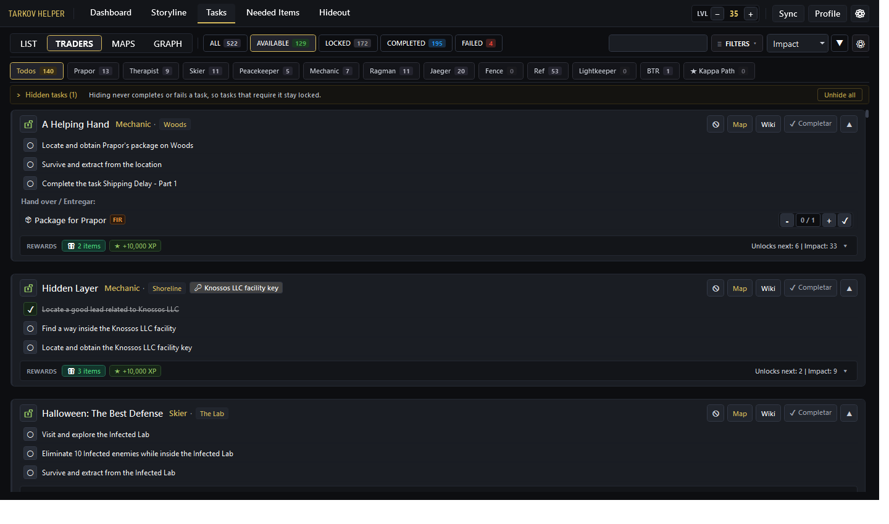
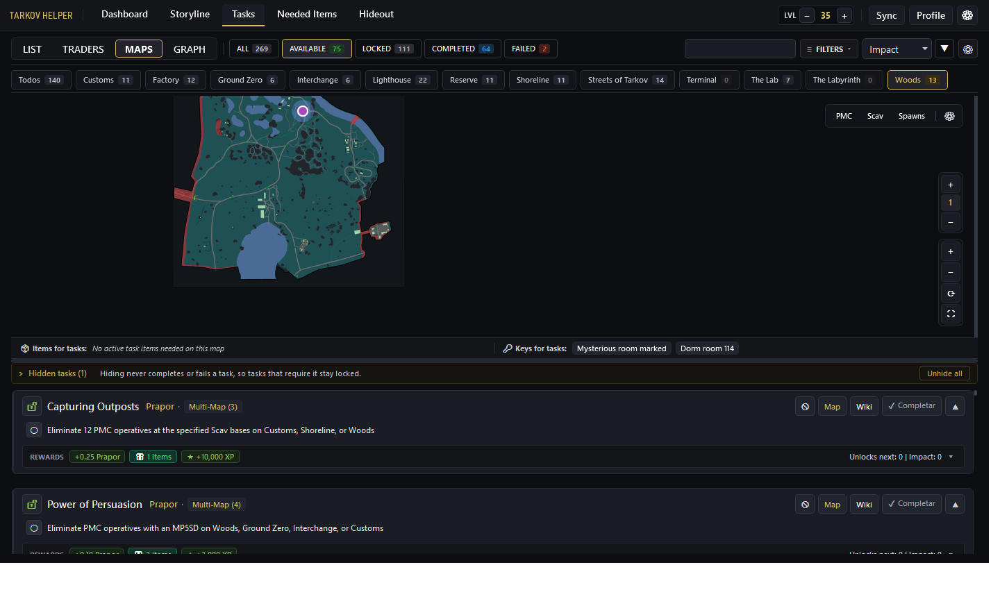
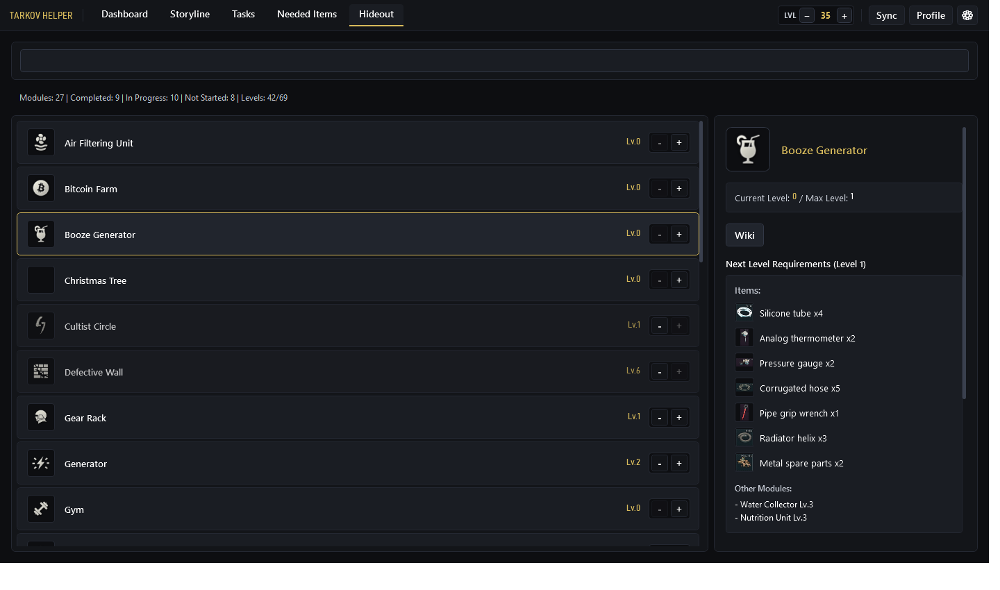

# Tarkov Helper

[](README.md)
[](README_ES.md)
[](README_KR.md)
[](README_JA.md)
[](https://microsoft.com/windows)
[](https://dotnet.microsoft.com/download/dotnet/8.0)
[](https://github.com/DenDiagonal/Tarkov-Helper/releases)
[](LICENSE)

**Tarkov Helper** は、Windows環境で **Escape from Tarkov** をプレイする際に、タスク進行状況、ハイドアウト（Hideout）の施設アップグレード、インレイド品（FIR）の要求数、鍵、そしてプレイヤーのリアルタイム位置追跡を支援する、モダンで高性能なオフライン対応タクティカルデスクトップコンパニオンです。ゲームメモリへのアクセスやDLLインジェクションを行わないため、BattlEyeアンチチート規約に100%準拠しています。

---

## 🌐 多言語サポート（4言語にネイティブ対応）

Tarkov Helper は、アプリの再起動なしでタスク、アイテム、トレーダー、マップ、UI全体を4言語に完全対応しています：
- **日本語** (Japanese - JA)
- **English** (英語 - EN)
- **Español** (スペイン語 - ES)
- **한국어** (韓国語 - KO)

**設定 (⚙) -> 言語 (Language)** メニューからいつでもリアルタイムに切り替え可能です。

---

## 📸 スクリーンショット

| タスク・クエスト管理 | インタラクティブ ベクターマップ & 階層切替 | ハイドアウト施設アップグレード |
| :---: | :---: | :---: |
|  |  |  |

---

## ✨ 主な機能

### 🎯 包括的なタスク・クエスト管理
- **タクティカル・タスクフィード:** EFTのタクティカルUIにインスパイアされた洗練されたデザイン。高速検索、トレーダー別フィルタリング、リアルタイムの進捗追跡。
- **586以上のタスク & 2,018以上の目標:** 全トレーダー（Prapor, Therapist, Skier, Peacekeeper, Mechanic, Ragman, Jaeger, Fence, Lightkeeper, BTRドライバー）を網羅。
- **動的マルチマップバッジ (Multi-Map):** 複数のマップにまたがるタスク（*Power of Persuasion*, *Capturing Outposts*, *A Shooter Born in Heaven* など）で対象マップをバッジ表示。
- **前提・派生タスクの依存ツリー:** 受託に必要な前提タスクや、完了時に解放される後続タスクを視覚的に把握。
- **Kappa & ストーリーライン指標:** カッパコンテナに必要なタスクや、ライトキーパー関連、ワイプ/シーズンイベント専用のフィルターとバッジ。
- **公式 Wiki へのワンクリックアクセス:** 各タスクやアイテムから公式 Escape from Tarkov Wiki への直接リンク。

### 🗺️ インタラクティブ多層SVGベクターマップ & 位置トラッキング
- **高解像度ベクターマップ:** EFTの全レイドマップ（Ground Zero, Customs, Streets of Tarkov, Woods, Factory, Reserve, Shoreline, Interchange, Lighthouse, The Lab）に対応。
- **地下・多層フロアに完全対応:** リザーブのバンカー、ラボの階層構造、インターチェンジの各階、カスタムの寮など、複雑な建物のフロア（Floor）を独立選択可能。
- **高度（Y軸）に応じた自動フロア切替:** プレイヤーの垂直座標に基づいて、表示階層を自動的に切り替え。
- **安全なパッシブ位置検出 (`PrintScreen`):** ゲーム内で `PrintScreen` キーを押すだけで、スクリーンショットのメタデータから現在地を安全に取得（メモリ読み書きを行わず、BattlEyeに完全準拠）。
- **透過オーバーレイ ミニマップ:** ボーダーレスかつクリックスルー可能なオーバーレイウィンドウ。サブモニターへの表示やゲーム画面上へのオーバーレイ配置が可能。
- **インタラクティブな目標マーカー位置微調整:** マップ上でタスク目標マーカーをドラッグして微調整可能。変更履歴管理とワンクリック初期化機能を搭載。

### ⌨️ グローバルショートカット & ミニマップクイックアクセス
- **上部ヘッダーのクイックボタン:** メイン上部バーの **🗺️** ボタンで、どのタブからでもワンクリックでミニマップの表示/非表示を切り替え（アクティブ時は青く点灯）。
- **`Ctrl + 1` (または `Ctrl + NumPad 1`):** ゲームプレイ中、デスクトップ、アプリ内のどこからでもミニマップオーバーレイを瞬時にトグル。
- **`Ctrl + 7` (または `Ctrl + NumPad 7`):** ミニマップ設定ダイアログを開く。
- **`Ctrl + 9` (または `Ctrl + NumPad 9`):** クリックスルー（Click-Through）モードの切り替え（ミニマップ背後のゲームを直接クリック操作可能）。
- **`NumPad 0 - 5`:** マップの階層（Floor/地下・地上）を即座に切り替え。

### 🔄 独立した PVP / PVE プロファイル管理
- **データ混信ゼロ:** ワンクリックで **PVP** と **PVE** のPMCプロファイルを切り替え可能。
- **分離された安全なデータ保存:** 完了タスク、鍵の所持状態、ハイドアウト施設レベル、ユーザーメモはローカルSQLite（`user_data.db`）にモード別で完全に分離保存。

### 📦 ハイドアウト（Hideout）プランナー & 必要素材トラッカー
- **モジュール施設アップグレード:** ビットコインファーム、インテリジェンスセンター、ソーラーパワーなど全施設の現在および目標レベルを管理。
- **FIR品（インレイド）と通常品の明確な分別:** レイド内発見（FIR）が必要な納品アイテムと通常のクラフト・取引素材を正確に区別して集計。
- **The Collector 専用トラッカー:** Fenceの最終タスクに必要なストリーマーアイテムの収集状況を一元管理。

### ⚡ リアルタイムデータ同期エンジン（Diff ビューアー）
- **ライブ API との同期:** **TarkovTracker** および **Tarkov.dev** の最新データとワンクリックで同期・照合。
- **視覚的 Diff ビューアー:** ゲームのアップデートに伴う変更・追加・削除タスクを適用前に並べて確認可能。
- **自動バックアップ & ロールバック:** データベース更新前にタイムスタンプ付きの `.bak` スナップショットを自動作成し、ワンクリックで復元可能。

### 🔒 100% オフライン動作 & メモリ非侵入の安全性
- **オフラインファースト:** 全ゲームデータ、アイコン、マップがローカルSQLite（`tarkov_data.db`）に保存され、インターネット接続がなくても利用可能。
- **非侵入型設計:** EFTのメモリを読み取ったり書き込んだりせず、DirectX/VulkanへのフックやDLLインジェクションは一切行いません。

---

## 🛠️ 技術スタック & アーキテクチャ

- **フレームワーク:** .NET 8.0 (C# 12, WPF)
- **アーキテクチャ:** MVVM (Model-View-ViewModel) パターン、非同期タスク処理
- **データベース:** SQLite (`Microsoft.Data.Sqlite`, ACIDトランザクション)
- **ベクターレンダリング:** `SharpVectors` によるリアルタイムSVG解析とGPUアクセラレーション描画
- **ログ監視:** `FileSystemWatcher` によるパッシブログ解析
- **配布形態:** 依存関係をすべて内包した `win-x64` 自己完結型（Self-Contained）パッケージ

---

## 🚀 ダウンロード & インストール

### 方法 1: ビルド済みバイナリのダウンロード（推奨）
1. [Releases](https://github.com/DenDiagonal/Tarkov-Helper/releases) ページから最新バージョン（`TarkovHelper-v1.5.8-win-x64.zip`）をダウンロードします。
2. 任意のフォルダー（例: `C:\Games\TarkovHelper`）に解凍します。
3. `TarkovHelper.exe` を実行します。
   - *注意:* 完全な自己完結型（Self-Contained）のため、別途 .NET ランタイムをインストールする必要はありません。

---

## 💻 ソースコードからのビルド

### 必要環境
- [Windows 10 / 11 (64-bit)](https://www.microsoft.com/windows)
- [.NET 8.0 SDK](https://dotnet.microsoft.com/download/dotnet/8.0)
- Visual Studio 2022（.NET デスクトップ開発ワークロード）または Visual Studio Code

### ビルド手順
```powershell
# 1. リポジトリのクローン
git clone https://github.com/DenDiagonal/Tarkov-Helper.git
cd Tarkov-Helper

# 2. Releaseモードでビルド
dotnet build TarkovHelper\TarkovHelper.csproj -c Release

# 3. publish/ フォルダーへ自己完結型（Self-Contained）で発行
dotnet publish TarkovHelper\TarkovHelper.csproj -c Release -r win-x64 --self-contained true -o publish
```

> [!IMPORTANT]
> 発行時は必ず `win-x64` 向けに `--self-contained true` を指定してください。発行後、`publish\TarkovHelper.runtimeconfig.json` に `"includedFrameworks"` が含まれていることを確認してください。

---

## 🤝 コントリビューション（貢献について）

開発者およびタルコフコミュニティからの貢献を歓迎します！UI/UXの改善、新しいマップオーバーレイの追加、ログパーサーの強化、翻訳のブラッシュアップなど、詳細は [CONTRIBUTING.md](CONTRIBUTING.md) をご覧ください。

---

## 📜 ライセンス & 免責事項

- 本プロジェクトは [MIT License](LICENSE) のもとで公開されています。
- **Escape from Tarkov** および関連するすべての資産、ロゴ、商標は **Battlestate Games Limited** に帰属します。
- 本アプリケーションはファンコミュニティによって開発された非公式ツールであり、Battlestate Games との提携や承認はありません。
