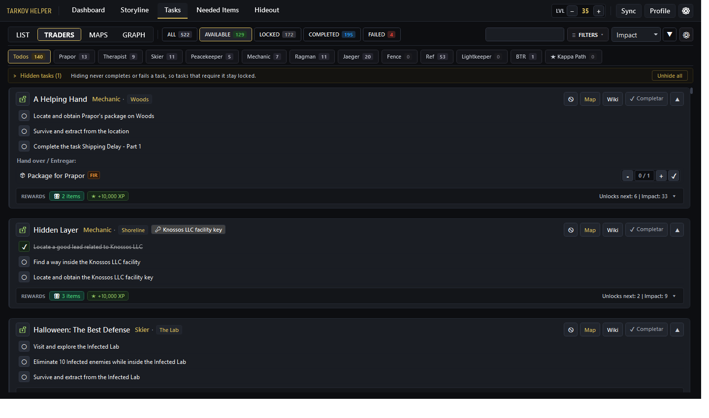
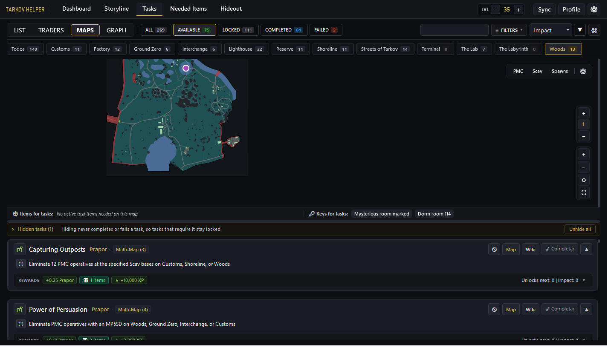
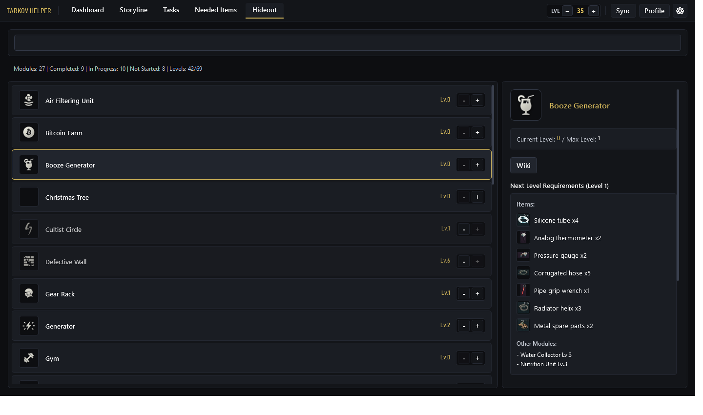

# Tarkov Helper

[](README.md)
[](README_ES.md)
[](README_KR.md)
[](README_JA.md)
[](https://microsoft.com/windows)
[](https://dotnet.microsoft.com/download/dotnet/8.0)
[](https://github.com/DenDiagonal/Tarkov-Helper/releases)
[](LICENSE)

**Tarkov Helper**는 Windows 환경에서 **Escape from Tarkov**를 플레이할 때 퀘스트 진행 상황, 은신처(Hideout) 모듈 업그레이드, 인레이드(FIR) 아이템 요구치, 필수 열쇠 및 실시간 플레이어 위치 추적이 가능한 현대적인 고성능 오프라인 지원 전술 데스크톱 보조 프로그램입니다. 게임 메모리에 침범하지 않으며 BattlEye 안티치트 규정을 100% 준수합니다.

---

## 🌐 다국어 지원 (4개 언어 완벽 지원)

Tarkov Helper는 앱 재시작 없이 퀘스트, 아이템, 상인, 지도 및 UI 전체를 4개 언어로 완전하게 지원합니다:
- **한국어** (Korean - KO)
- **English** (영어 - EN)
- **Español** (스페인어 - ES)
- **日本語** (일본어 - JA)

**설정 (⚙) -> 언어(Language)** 메뉴에서 언제든지 실시간으로 변경할 수 있습니다.

---

## 📸 스크린샷

| 퀘스트 및 임무 관리 | 대화형 벡터 지도 & 층수 전환 | 은신처 및 모듈 업그레이드 |
| :---: | :---: | :---: |
|  |  |  |

---

## ✨ 주요 기능

### 🎯 체계적인 퀘스트 및 임무 관리
- **전술 퀘스트 피드:** EFT 전술 색상 및 TarkovTracker 스타일을 반영한 직관적인 인터페이스, 빠른 검색, 상인별 필터링 및 실시간 진행 상태 관리.
- **586개 이상의 퀘스트 & 2,018개 이상의 목표:** 모든 상인(Prapor, Therapist, Skier, Peacekeeper, Mechanic, Ragman, Jaeger, Fence, Lightkeeper 및 BTR 운전수) 완벽 지원.
- **동적 멀티 맵 배지 (Multi-Map):** 여러 맵에 걸쳐 수행하는 퀘스트(*Power of Persuasion*, *Capturing Outposts*, *A Shooter Born in Heaven* 등)의 해당 맵들을 실시간 뱃지로 표시.
- **선행/후속 퀘스트 의존성 트리:** 선행 필수 퀘스트와 완료 시 해금되는 후속 임무를 시각적으로 명확하게 파악.
- **카파(Kappa) 및 스토리라인 지표:** 카파 컨테이너 필수 퀘스트 및 라이트키퍼/시즌 초기화 이벤트 전용 필터와 배지 제공.
- **공식 Escape from Tarkov Wiki 연동:** 모든 퀘스트 및 아이템에서 원클릭으로 공식 영문/한글 위키 문서 확인.

### 🗺️ 대화형 다층 SVG 벡터 지도 및 플레이어 위치 추적
- **고해상도 벡터 지도:** 모든 EFT 레이드 맵(Ground Zero, Customs, Streets of Tarkov, Woods, Factory, Reserve, Shoreline, Interchange, Lighthouse, The Lab) 지원.
- **지하 및 다층 구조 완벽 대응:** 리저브 벙커, 랩 층별 구조, 인터체인지 층수, 커스텀 기숙사 등 복잡한 실내/지하 구역의 독립적인 층(Floor) 선택 제공.
- **고도 기반 자동 층수 전환:** 플레이어의 Y축 고도 좌표에 따라 표시 중인 지도 층을 자동으로 전환.
- **안전한 비침습식 위치 추적 (`PrintScreen`):** 게임 내에서 `PrintScreen` 키를 누르면 스크린샷 메타데이터를 수동적(Passive)으로 감지하여 지도에 실시간 위치 표시 (메모리 해킹/DLL 인젝션이 없어 BattlEye 100% 안전).
- **투명 오버레이 미니맵:** 보더리스 투명 오버레이를 통해 보조 모니터 또는 게임 화면 위에 바로 띄워 확인 가능.
- **대화형 퀘스트 마커 위치 조정:** 지도 위에서 퀘스트 목표 마커의 위치를 직접 드래그하여 미세 조정할 수 있으며, 변경 이력 관리 및 원클릭 기본값 복원 지원.

### ⌨️ 글로벌 단축키 및 미니맵 빠른 접근
- **상단 헤더 원클릭 버튼:** 상단 바의 **🗺️** 버튼으로 어느 탭에서든 즉시 미니맵 켜기/끄기 토글 (활성화 시 파란색으로 점등).
- **`Ctrl + 1` (또는 `Ctrl + NumPad 1`):** 게임 플레이 중, 바탕화면, 프로그램 어디서든 미니맵 오버레이 토글.
- **`Ctrl + 7` (또는 `Ctrl + NumPad 7`):** 미니맵 설정 대화 상자 열기.
- **`Ctrl + 9` (또는 `Ctrl + NumPad 9`):** 클릭 관통(Click-Through) 모드 토글 (미니맵 너머로 게임 조작 가능).
- **`NumPad 0 - 5`:** 지도의 건물/지하 층수(Floor) 즉각 변경.

### 🔄 독립적인 PVP 및 PVE 프로필 분리
- **프로필 상호 오염 방지:** 단 한 번의 클릭으로 **PVP**와 **PVE** PMC 프로필 전환.
- **안전한 독립 데이터 저장:** 완료된 퀘스트, 소지한 열쇠, 은신처 업그레이드 단계 및 메모가 로컬 SQLite(`user_data.db`)에 모드별로 완전 분리 저장.

### 📦 은신처(Hideout) 플래너 및 필요 재료 추적
- **시설별 업그레이드 로드맵:** 비트코인 팜, 정보 센터, 태양광 발전기 등 모든 은신처 시설의 현재 및 목표 레벨 추적.
- **인레이드(FIR) vs 일반 아이템 구분:** 인레이드 발견(FIR)이 필수인 아이템과 일반 제작/물꼬 트기용 재료를 정확하게 구분하여 집계.
- **The Collector 전용 추적기:** 펜스의 최종 카파 퀘스트에 필요한 희귀 스트리머 아이템 수집 현황을 한눈에 파악.

### ⚡ 실시간 데이터 동기화 엔진 (Diff 뷰어)
- **공식 API 실시간 동기화:** **TarkovTracker** 및 **Tarkov.dev** 라이브 API를 통해 변경된 퀘스트 목표와 데이터를 원클릭으로 동기화.
- **시각적 Diff 뷰어:** 게임 패치로 인해 변경, 추가, 삭제된 퀘스트 내용을 적용 전에 나란히 비교 검토.
- **자동 백업 및 롤백:** 데이터베이스 업데이트 전 자동으로 타임스탬프가 찍힌 `.bak` 스냅샷을 생성하여 문제 발생 시 원클릭 복구 지원.

### 🔒 100% 오프라인 작동 및 완벽한 보안
- **오프라인 우선 (Offline-First):** 모든 데이터, 아이콘, 지도가 로컬 SQLite(`tarkov_data.db`)에 영구 저장되어 인터넷 연결 없이도 원활하게 사용 가능.
- **비침습식 안전 설계:** EFT의 프로세스 메모리를 읽거나 쓰지 않으며, DirectX/Vulkan 후킹이나 DLL 인젝션을 전혀 사용하지 않습니다.

---

## 🛠️ 기술 스택 및 아키텍처

- **프레임워크:** .NET 8.0 (C# 12, WPF)
- **아키텍처:** MVVM (Model-View-ViewModel) 패턴 및 비동기 작업 스케줄링
- **데이터베이스:** SQLite (`Microsoft.Data.Sqlite`, ACID 트랜잭션 보장)
- **벡터 렌더링:** `SharpVectors` 실시간 SVG 파싱 및 GPU 가속 캔버스 렌더링
- **로그 모니터링:** `FileSystemWatcher` 기반 비침습식 로그 파싱
- **배포 방식:** 종속성이 모두 포함된 `win-x64` 단일 독립형(Self-Contained) 배포

---

## 🚀 다운로드 및 설치

### 방법 1: 빌드된 실행 파일 다운로드 (권장)
1. [Releases](https://github.com/DenDiagonal/Tarkov-Helper/releases) 페이지에서 최신 버전(`TarkovHelper-v1.5.8-win-x64.zip`)을 다운로드합니다.
2. 원하는 폴더(예: `C:\Games\TarkovHelper`)에 압축을 풉니다.
3. `TarkovHelper.exe`를 실행합니다.
   - *참고:* 완전한 독립형(Self-Contained) 빌드이므로 별도의 .NET 런타임을 설치할 필요가 없습니다.

---

## 💻 소스 코드 빌드

### 사전 준비 사항
- [Windows 10 / 11 (64-bit)](https://www.microsoft.com/windows)
- [.NET 8.0 SDK](https://dotnet.microsoft.com/download/dotnet/8.0)
- Visual Studio 2022 (.NET 데스크톱 개발 워크로드 포함) 또는 Visual Studio Code

### 빌드 및 배포 명령어
```powershell
# 1. 저장소 클론
git clone https://github.com/DenDiagonal/Tarkov-Helper.git
cd Tarkov-Helper

# 2. Release 모드로 빌드
dotnet build TarkovHelper\TarkovHelper.csproj -c Release

# 3. publish/ 폴더로 독립형(Self-Contained) 배포 실행
dotnet publish TarkovHelper\TarkovHelper.csproj -c Release -r win-x64 --self-contained true -o publish
```

> [!IMPORTANT]
> 로컬 배포 시 항상 `win-x64` 대상 `--self-contained true` 옵션을 사용하세요. 배포 후 `publish\TarkovHelper.runtimeconfig.json`에 `"includedFrameworks"`가 포함되어 있는지 확인해야 합니다.

---

## 🤝 기여하기 (Contributing)

개발자 및 타르코프 유저 여러분의 기여를 언제나 환영합니다! UI/UX 개선, 새로운 지도 오버레이 추가, 로그 파서 향상, 번역 개선 등 어떤 기여든 [CONTRIBUTING.md](CONTRIBUTING.md)를 참고해 참여해 주세요.

---

## 📜 라이선스 및 법적 고지

- 본 프로젝트는 [MIT License](LICENSE)에 따라 배포됩니다.
- **Escape from Tarkov** 및 관련 모든 자산, 상표, 로고는 **Battlestate Games Limited**의 자산입니다.
- 본 애플리케이션은 팬 커뮤니티에서 개발한 비공식 도구이며, Battlestate Games와 제휴하거나 보증받지 않았습니다.
